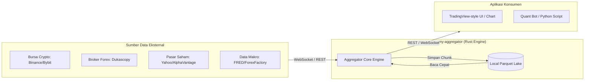

# 3. Context and Scope

> [!INFO] **Architecture Provenance & Freshness**
> - **Verified Commit**: `271cb11`
> - **Verified Timestamp**: `2026-10-30T18:53:00+07:00`
> - **Tracked Paths**: `src/`, `Cargo.toml`
> - **Drift Status**: `verified`

## 3.1 Business Context
Sistem `economy-aggregator` memposisikan diri sebagai jembatan pengumpul data otomatis antara bursa/sumber eksternal dengan aplikasi analisis lokal.

## 3.2 External Technical Interfaces

| ID | Nama Antarmuka | Arah | Protokol & Format | Penjelasan Singkat |
| :--- | :--- | :--- | :--- | :--- |
| **IF-01** | Ingesti Live WebSocket | Masuk | WebSocket (`wss://`), JSON / Text | Menerima aliran tick dan candle langsung saat transaksi terjadi di bursa. |
| **IF-02** | Ingesti Batch & Backfill REST | Masuk | HTTP (`https://`), JSON / CSV | Mengunduh data historis atau mengisi kembali kekosongan data saat stream terputus. |
| **IF-03** | Penyimpanan Lokal Parquet | Lokal | File Disk, Apache Parquet (ZSTD) | Menyimpan data terpartisi rapi berdasarkan kategori, simbol, dan bulan. |
| **IF-04** | REST Query API | Keluar | HTTP REST (`http://`), JSON / Arrow | Melayani permintaan data rentang waktu untuk grafik dan analisis. |
| **IF-05** | Real-Time Broadcast Stream | Keluar | WebSocket (`ws://`), JSON | Meneruskan data harga terbaru secara langsung ke layar pengguna. |
| **IF-06** | Agent-First Management & Query CLI | Keluar/Masuk | CLI Stdio, JSON Envelope | Mengontrol konfigurasi, inisialisasi, backfill 2020, dan audit kesehatan secara headless bagi agen AI dan operator. |
