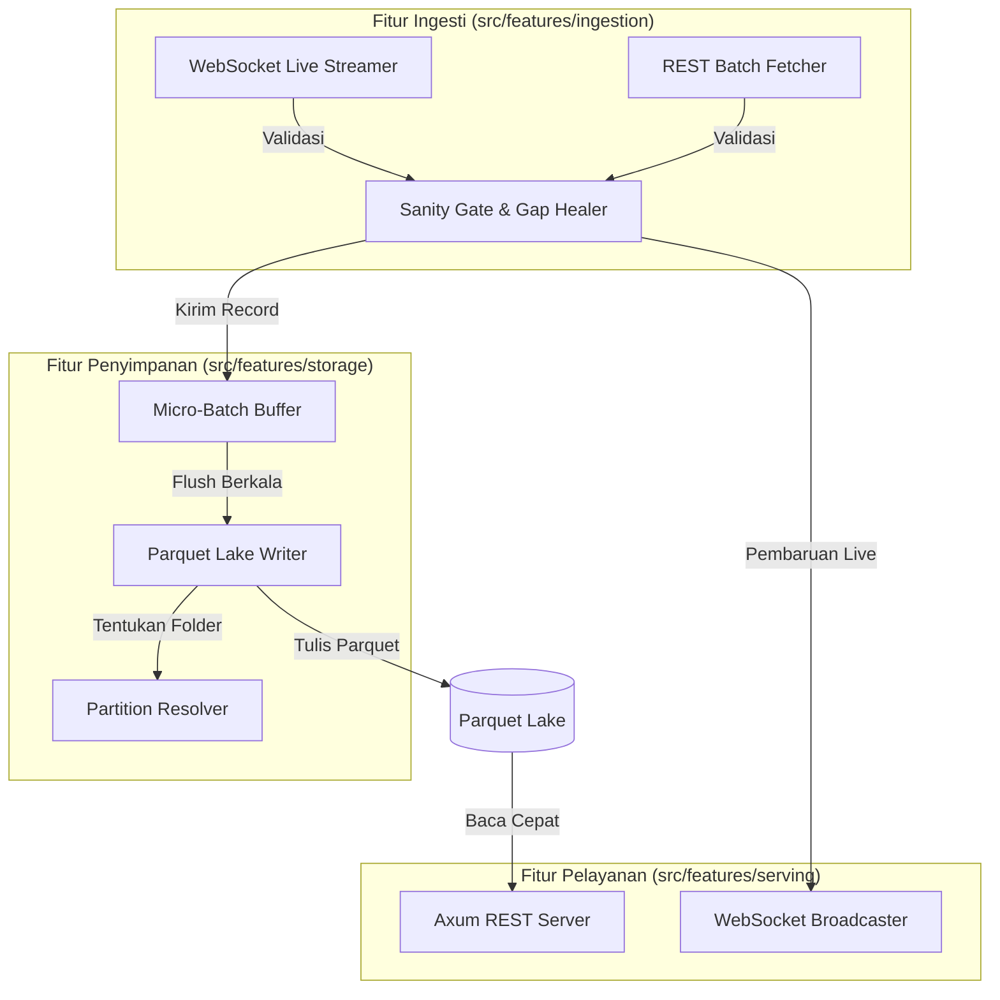

# 5. Building Block View

> [!INFO] **Architecture Provenance & Freshness**
> - **Verified Commit**: `ceeac71`
> - **Verified Timestamp**: `2026-10-30T14:52:27+07:00`
> - **Tracked Paths**: `src/`, `Cargo.toml`
> - **Drift Status**: `verified`

## 5.1 Level 1: System Decomposition

Sistem dibagi menjadi modul-modul independen dengan tanggung jawab tunggal (Vertical Slice Architecture):



### 5.1.1 Level 1 Component Catalog

| Komponen | Tanggung Jawab Utama | Antarmuka Terkait |
| :--- | :--- | :--- |
| **Ingestion Engine** | Menangani koneksi jaringan ke bursa luar, baik secara live stream maupun unduhan berkala. | `IF-01`, `IF-02` |
| **Sanity Gate & Gap Healer** | Memfilter data rusak (harga minus atau tanggal rusak) dan mendeteksi data bolong untuk ditambal ulang. | `IF-01`, `IF-02` |
| **Micro-Batch Buffer** | Menampung data masuk di RAM secara aman sebelum dieksekusi ke harddisk. | `IF-01`, `IF-03` |
| **Parquet Lake Writer** | Menulis data terkompresi ke partisi Parquet sesuai format folder Hive. | `IF-03` |
| **Serving Engine** | Menyediakan jalur bagi aplikasi luar untuk mengambil data via REST API atau WebSocket real-time. | `IF-04`, `IF-05` |

---

## 5.2 Level 2: Detail Struktur Kode (Rust Layout)

```
src/
├── main.rs                   # Titik masuk program utama & inisialisasi server
├── core/                     # Model data dasar dan konfigurasi
│   ├── mod.rs
│   ├── config.rs             # Konfigurasi batas RAM, folder data, dan interval
│   └── types.rs              # Struct data: Candle, Tick, Mapping, MacroEvent
└── features/
    ├── ingestion/            # Slice Ingesti
    │   ├── mod.rs
    │   ├── live_stream.rs    # Klien WebSocket tokio-tungstenite
    │   ├── batch_fetcher.rs  # Klien HTTP reqwest
    │   ├── sanity_gate.rs    # Filter anti-data kotor & deteksi gap
    │   └── symbology.rs      # Tabel penerjemah simbol universal
    ├── storage/              # Slice Penyimpanan
    │   ├── mod.rs
    │   ├── buffer.rs         # Bounded micro-batch buffer thread-safe
    │   ├── partition.rs      # Resolver path partisi Hive
    │   └── writer.rs         # Writer file Parquet ZSTD
    └── serving/              # Slice Pelayanan API
        ├── mod.rs
        ├── rest_api.rs       # Router HTTP Axum untuk query candle
        └── live_channel.rs   # Channel WebSocket Axum untuk push data
```
