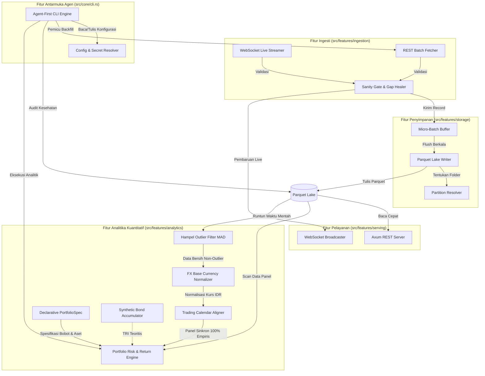

# 5. Building Block View

> [!INFO] **Architecture Provenance & Freshness**
> - **Verified Commit**: `4e98035`
> - **Verified Timestamp**: `2026-10-30T20:29:28+07:00`
> - **Tracked Paths**: `src/`, `Cargo.toml`
> - **Drift Status**: `verified`

## 5.1 Level 1: System Decomposition

Sistem dibagi menjadi modul-modul independen dengan tanggung jawab tunggal (Vertical Slice Architecture):



### 5.1.1 Level 1 Component Catalog

| Komponen | Tanggung Jawab Utama | Antarmuka Terkait |
| :--- | :--- | :--- |
| **Ingestion Engine** | Menangani koneksi jaringan ke bursa luar, baik secara live stream maupun unduhan berkala. | `IF-01`, `IF-02` |
| **Sanity Gate & Gap Healer** | Memfilter data rusak (harga minus atau lonjakan anomali) dan mendeteksi data bolong untuk ditambal ulang. | `IF-01`, `IF-02` |
| **Micro-Batch Buffer** | Menampung data masuk di RAM secara aman sebelum dieksekusi ke harddisk. | `IF-01`, `IF-03` |
| **Parquet Lake Writer & Compactor** | Menulis data terkompresi ke partisi Parquet Hive dan memadatkan micro-chunks menjadi single file bulanan. | `IF-03` |
| **Serving Engine** | Menyediakan jalur bagi aplikasi luar untuk mengambil data via REST API atau WebSocket real-time. | `IF-04`, `IF-05` |
| **Quantitative Analytics Engine** | Menyediakan sinkronisasi kalender multi-bursa, normalisasi FX, sintesis kupon obligasi, dan kalkulasi risiko portofolio (CAGR, Volatilitas, Max Drawdown, Sharpe, Korelasi). | `IF-07` |
| **Agent-First CLI & Config Engine** | Menyediakan eksekusi perintah headless, inisialisasi konfigurasi deklaratif, dan orkestrasi backfill 2020 via JSON envelope. | `IF-06` |

---

## 5.2 Level 2: Detail Struktur Kode (Rust Layout)

```
src/
├── main.rs                   # Titik masuk program utama & inisialisasi server
├── core/                     # Model data dasar dan konfigurasi
│   ├── mod.rs
│   ├── types.rs              # AggregatorCandle, EconomicEventRecord, Enums
│   ├── config.rs             # LakehouseConfig & batas budget memori
│   └── cli.rs                # Agent-First CLI dispatcher & argument parser
├── features/                 # Vertical Slice Architecture
│   ├── ingestion/            # SanityGate, Binance WS/REST, Yahoo Ingestion, Economic Calendar
│   ├── storage/              # Parquet Writer, Compactor, Hive Resolver, Symbology
│   ├── analytics/            # Calendar Aligner, FX Normalizer, HampelFilter, PortfolioSpec, Portfolio Engine
│   └── serving/              # Axum REST endpoints (/health, /candles, /stats)
economy-aggregator.toml       # Template konfigurasi deklaratif 'one-config-away'
```
