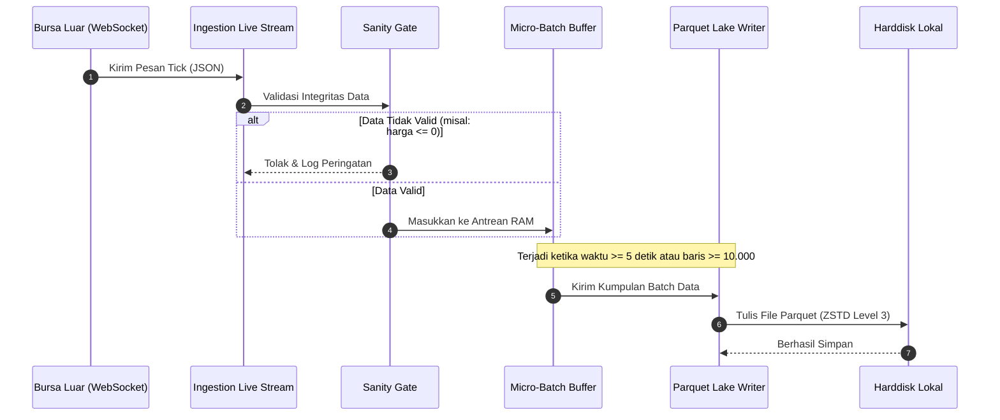
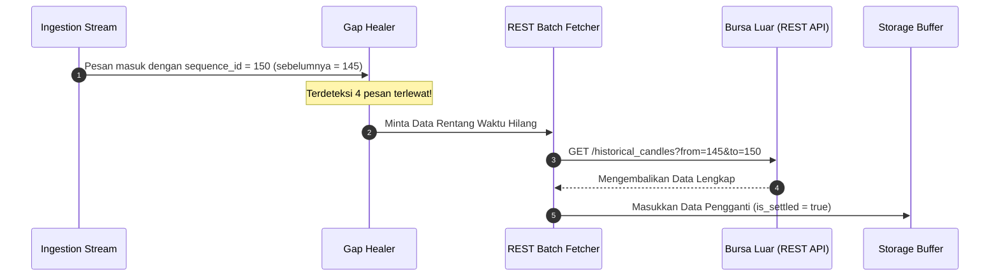
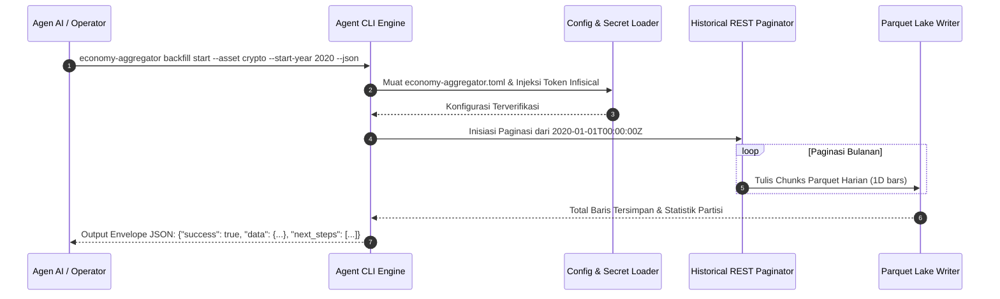

# 6. Runtime View

> [!INFO] **Architecture Provenance & Freshness**
> - **Verified Commit**: `cc06233`
> - **Verified Timestamp**: `2026-10-30T16:05:09.720863+07:00`
> - **Tracked Paths**: `src/`, `Cargo.toml`
> - **Drift Status**: `verified`

## 6.1 Skenario 1: Penerimaan Data Live & Penulisan ke Disk

Menjelaskan alur saat pesan tick dari bursa masuk hingga tersimpan di file Parquet:

## 6.2 Skenario 2: Deteksi Gap & Penambalan Otomatis (*Gap Healing*)

Menjelaskan alur saat koneksi internet sempat putus dan data tertinggal:

## 6.3 Skenario 3: Konsumsi Data Historis via REST API

Aplikasi grafik atau skrip analis meminta data historis:

1. Klien mengirim permintaan `GET /v1/market/candles?symbol=BTC/USDT&timeframe=1m&from=...&to=...`.
2. Router `Axum` mengarahkan permintaan ke modul pembaca Parquet.
3. Pembaca langsung menuju folder partisi tanggal yang sesuai (*folder pruning*).
4. Data dikirimkan kembali ke klien dalam format JSON terkompresi atau stream Arrow.

## 6.4 Skenario 4: Eksekusi Backfill Historis 2020 via Agent-First CLI

Alur saat Agen AI atau operator mengeksekusi penarikan data historis sejak tahun 2020 secara headless:

