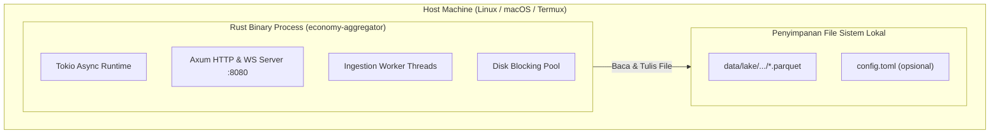

# 7. Deployment View

> [!INFO] **Architecture Provenance & Freshness**
> - **Verified Commit**: `0a4caf6`
> - **Verified Timestamp**: `2026-10-30T19:42:18+07:00`
> - **Tracked Paths**: `src/`, `Cargo.toml`
> - **Drift Status**: `verified`

## 7.1 Infrastructure & Deployment Models

Sistem `economy-aggregator` dirancang sebagai file binary tunggal (*self-contained single executable*) yang dapat dijalankan langsung di berbagai lingkungan tanpa ketergantungan software eksternal:

## 7.2 Target Environments & Hardware Requirements

| Parameter | Lingkungan Lokal (Laptop / Termux) | Lingkungan Produksi (Server / VPS) |
| :--- | :--- | :--- |
| **Sistem Operasi** | Linux aarch64 (Termux) / macOS / Ubuntu | Debian / Ubuntu Linux x86_64 / aarch64 |
| **Bentuk Distribusi**| Executable native hasil `cargo build --release` | Docker container ramping (scratch/distroless) |
| **CPU Minimal** | 2 Core CPU (ARM atau x86) | 2 Core CPU |
| **RAM Minimal** | 256 MB total RAM mesin (aplikasi memakai < 50 MB) | 512 MB total RAM mesin |
| **Penyimpanan Disk** | Minimal 2 GB SSD kosong untuk file data Parquet | 50+ GB NVMe SSD |
| **Port Jaringan** | Port `8080` (REST & WebSocket) | Port `8080` di balik reverse proxy (Nginx/Caddy) |
