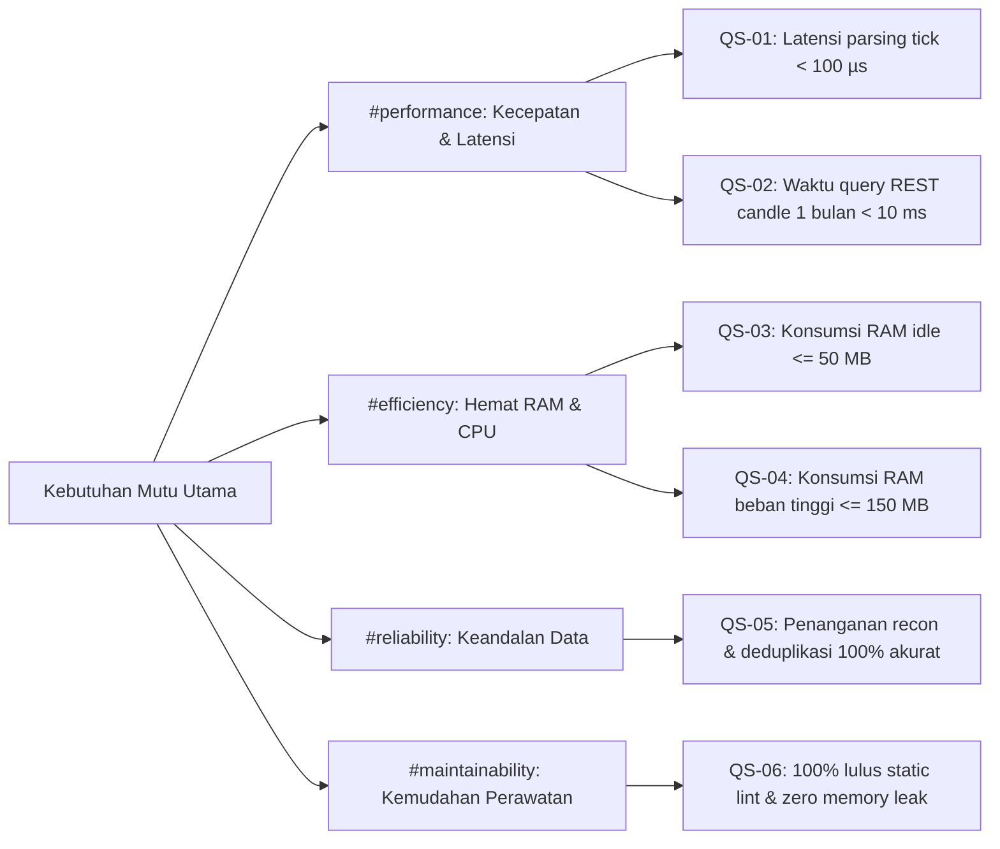

# 10. Quality Requirements

> [!INFO] **Architecture Provenance & Freshness**
> - **Verified Commit**: `329892f`
> - **Verified Timestamp**: `2026-10-30T15:33:05.959236+07:00`
> - **Tracked Paths**: `src/`, `Cargo.toml`
> - **Drift Status**: `verified`

## 10.1 Quality Tree
Kebutuhan kualitas sistem dipetakan langsung ke skenario pengujian yang dapat diverifikasi secara deterministik:

## 10.2 Quality Scenarios

| Skenario | Kategori Mutu | Stimulus / Kondisi Uji | Respons & Toleransi Terukur |
| :--- | :--- | :--- | :--- |
| **QS-01** | #performance | 50.000 pesan tick masuk secara bersamaan melalui WebSocket. | Sistem memvalidasi dan memproses tiap tick dalam waktu rata-rata di bawah 100 mikrodetik. |
| **QS-02** | #performance | Klien meminta 43.200 baris candle (1 bulan data 1-menit) via REST API. | Endpoint memberikan response lengkap dalam waktu di bawah 10 milidetik berkat pemangkasan partisi folder. |
| **QS-03** | #efficiency | Sistem berjalan tanpa beban transaksi aktif selama 24 jam. | Total memori RAM yang digunakan tidak melebihi 50 MB secara konsisten. |
| **QS-04** | #efficiency | Sistem menerima arus deras 50.000 tick/detik secara berkelanjutan. | Kapasitas antrean memori tertahan di angka aman, total RAM tidak melebihi 150 MB. |
| **QS-05** | #reliability | Koneksi WebSocket terputus selama 60 detik lalu tersambung kembali. | Detektor gap mendeteksi data yang hilang, mengunduh via REST, dan menyatukannya tanpa duplikasi record. |
| **QS-06** | #maintainability | Menjalankan seluruh test suite dan linter otomatis Rust (`cargo clippy`, `cargo test`). | 100% test lulus, nol peringatan keamanan (*zero warnings*), dan bebas dari kebocoran memori. |
