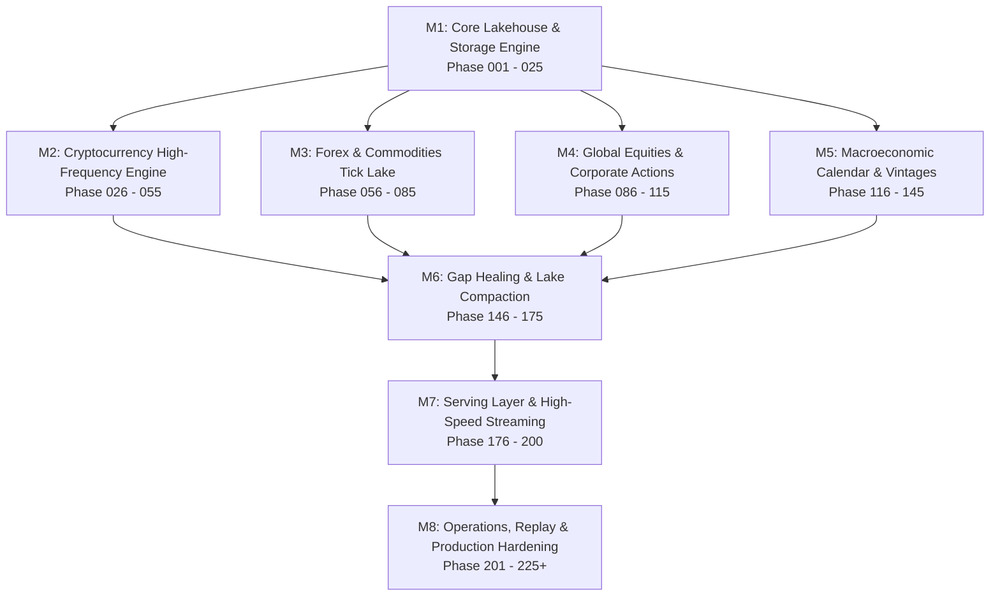

# Master Implementation Roadmap: Economy Aggregator

**Scope:** Production-Grade High-Performance Financial & Macroeconomic Data Aggregator  
**Target Runtime:** 100% Native Rust (Zero-GC, Memory Budget $\le$ 50 MB Idle / $\le$ 150 MB Load)  
**Total Granular Phases:** 225 Atomic Implementation Phases across 8 Major Milestones.

---

## 1. Executive Summary & Milestone Overview

This master roadmap outlines the step-by-step engineering trajectory to scale `economy-aggregator` from its foundational columnar storage engine into an enterprise-grade multi-asset data aggregator.

---

## 2. Milestone Directory & Phase Catalog

| Milestone | Title & Domain | Phase Range | Status | Documentation File |
| :--- | :--- | :--- | :--- | :--- |
| **M1** | **Core Engine & Columnar Lakehouse** | Phase 001 – 025 | In Progress | [milestone_1_core_storage.md](milestone_1_core_storage.md) |
| **M2** | **Cryptocurrency High-Frequency Engine** | Phase 026 – 055 | Planned | [milestone_2_crypto.md](milestone_2_crypto.md) |
| **M3** | **Forex & Commodities Tick Lake** | Phase 056 – 085 | Planned | [milestone_3_forex_commodities.md](milestone_3_forex_commodities.md) |
| **M4** | **Global Equities & Corporate Actions** | Phase 086 – 115 | Planned | [milestone_4_equities.md](milestone_4_equities.md) |
| **M5** | **Macroeconomic Calendar & SDMX Vintages** | Phase 116 – 145 | Planned | [milestone_5_macro_calendar.md](milestone_5_macro_calendar.md) |
| **M6** | **Gap Healing, Dedup & Lake Compactor** | Phase 146 – 175 | Planned | [milestone_6_resilience_compactor.md](milestone_6_resilience_compactor.md) |
| **M7** | **Serving Layer (REST, WS & Arrow Flight)** | Phase 176 – 200 | Planned | [milestone_7_serving_streaming.md](milestone_7_serving_streaming.md) |
| **M8** | **Observability, Replay & Production Ops** | Phase 201 – 225+ | Planned | [milestone_8_operations_replay.md](milestone_8_operations_replay.md) |

---

## 3. Engineering Invariants for All Phases

1. **Test-Driven Development (TDD):**
   - RED: Failing unit/integration test written first.
   - GREEN: Minimal idiomatic Rust code to pass the test.
   - REFACTOR: Optimize memory, eliminate redundant allocations, enforce SRP.
2. **Performance & Memory Budgets:**
   - Every phase must maintain idle RAM $\le$ 50 MB.
   - Hot-path parsing must not allocate strings dynamically on the heap.
   - Antreans must remain strictly bounded (`bounded channel` size $\le$ 50,000).
3. **Evidence-First Verification:**
   - Pre-commit gates (`osv-scanner-gate`, `arc42-lint`) must exit with code 0 before every push.
   - All tests must pass with `cargo test`.
